# BÁO CÁO ĐỒ ÁN CUỐI KỲ TUẦN 1
## Môn Điện Toán Đám Mây — Dự án Số hóa Hóa đơn và Biểu mẫu với Amazon Textract

**Học kỳ 1 – Năm học 2026 – 2027**  
**GVHD:** TS. Huỳnh Xuân Phụng  
**Mã học phần:** 261CLCO332779_05  

| Họ và tên | MSSV |
| --- | --- |
| Ninh Nguyễn Minh Tuyên | 24110372 |
| Nguyễn Quốc Việt | 24110381 |

---

## 1. Giới thiệu

Dự án hướng đến xây dựng một quy trình xử lý tài liệu theo kiến trúc serverless nhằm số hóa hóa đơn và biểu mẫu được quét. Trong kiến trúc dự kiến, Amazon S3 lưu trữ tài liệu đầu vào và dữ liệu đầu ra; AWS Lambda điều phối quá trình xử lý; Amazon Textract trích xuất thông tin từ tài liệu; Amazon DynamoDB lưu trữ kết quả; Amazon SNS gửi thông báo trạng thái; và Amazon CloudWatch ghi nhận nhật ký hoạt động cùng các chỉ số giám sát.

Trong tuần 1, nhóm tập trung xác định kiến trúc tổng thể, kiểm tra môi trường AWS Academy Learner Lab, khởi tạo các tài nguyên nền tảng và kiểm thử khả năng tích hợp giữa Amazon S3 và AWS Lambda. Việc tích hợp Amazon Textract, lưu kết quả vào DynamoDB và tạo tệp CSV từ dữ liệu trích xuất được chuyển sang giai đoạn triển khai tiếp theo.

## 2. Mục tiêu và phạm vi tuần 1

Nhóm dùng Region us-east-1 và IAM role LabRole có sẵn trong AWS Academy Learner Lab. Trong tuần 1, nhóm cũng tạo VPC riêng, hai subnet và kiểm tra route table chính.

Nhóm tạo các tài nguyên nền tảng gồm VPC, hai subnet, S3 bucket, DynamoDB table, SNS topic, Lambda Processor và Lambda Exporter ở mức skeleton; nhóm gắn tags Project và Owner cho các tài nguyên chính đã tạo.

Cấu hình S3 event notification áp dụng cho prefix input/ nhằm kích hoạt Lambda Processor khi có đối tượng mới được tải lên, đồng thời hạn chế việc xử lý lặp đối với các đối tượng trong prefix output/.

Thực hiện kiểm thử ban đầu bằng tệp smoke-test.txt, kiểm tra nhật ký trên CloudWatch Logs và sử dụng tệp CSV giả để kiểm tra hành vi của prefix output/.

Nhóm đọc yêu cầu, tìm hiểu các dịch vụ và vẽ sơ đồ trước khi vào Learner Lab. Sau đó nhóm kiểm tra LabRole, tạo VPC và subnet, dựng các tài nguyên AWS, cấu hình S3 trigger rồi chạy smoke test.

| Bước | Công việc | Kết quả / quyết định |
| --- | --- | --- |
| 1 | Đọc đề tài và yêu cầu tuần 1 | Nhóm nghiên cứu yêu cầu của đề tài và xác định phạm vi công việc trong tuần đầu, bao gồm tìm hiểu các dịch vụ AWS, xây dựng kiến trúc tổng thể và khởi tạo các tài nguyên nền tảng. Việc tích hợp Textract và đánh giá trên 30 tài liệu mẫu được chuyển sang giai đoạn tiếp theo. |
| 2 | Tìm hiểu các dịch vụ liên quan | Nhóm xác định vai trò dự kiến của từng dịch vụ trong hệ thống: Amazon S3 lưu trữ tài liệu đầu vào và dữ liệu đầu ra; AWS Lambda thực hiện xử lý và xuất dữ liệu; Amazon Textract trích xuất thông tin; Amazon DynamoDB lưu kết quả; Amazon SNS gửi thông báo; và Amazon CloudWatch phục vụ giám sát, ghi nhật ký. |
| 3 | Phác thảo kiến trúc và phạm vi triển khai | Nhóm xây dựng sơ đồ kiến trúc tổng thể, đồng thời phân định rõ luồng được kiểm thử trong tuần 1 và các chức năng dự kiến triển khai ở giai đoạn tiếp theo. Phạm vi kiểm thử ban đầu tập trung vào luồng sự kiện từ S3 đến Lambda Processor và việc ghi nhận nhật ký trên CloudWatch. |
| 4 | Chuẩn bị quy ước và kế hoạch kiểm tra | Chọn us-east-1, dùng LabRole, thống nhất tags, tạo VPC và hai subnet; chuẩn bị prefix input/output cùng tệp kiểm thử. |
| 5 | Kiểm tra môi trường Learner Lab | Nhóm truy cập AWS Console để xác nhận Region và kiểm tra IAM role LabRole trước khi khởi tạo tài nguyên. |
| 6 | Tạo nền tảng AWS theo kiến trúc | Tạo VPC, hai subnet, S3 bucket, DynamoDB table, SNS topic/subscription và hai Lambda skeleton; gắn tags cho VPC, subnet, route table và các tài nguyên chính đã tạo. |
| 7 | Cấu hình tích hợp và xử lý lỗi | Nhóm cấu hình S3 event notification cho prefix input/. Khi thao tác tạo trigger lần đầu không thành công, nhóm kiểm tra quyền gọi hàm Lambda từ S3, bổ sung quyền cần thiết theo phạm vi bucket và tài khoản đã xác định, sau đó thực hiện lại thao tác cấu hình. |
| 8 | Chạy kiểm tra và ghi nhận kết quả | Upload smoke-test.txt, xác nhận log RECEIVED trong CloudWatch; upload CSV giả vào output/ và kiểm tra không phát sinh invocation mới. Sau đó tổng hợp phần đã đạt. |

## 3. Thông tin môi trường và quyết định kiến trúc

Nhóm mở AWS Academy Learner Lab từ học phần trên Canvas và làm việc ở Region US East (N. Virginia), mã us-east-1. Account chính của báo cáo là 535709085695; một số hình minh chứng khác do thành viên ghi nhận từ account 993288790379.

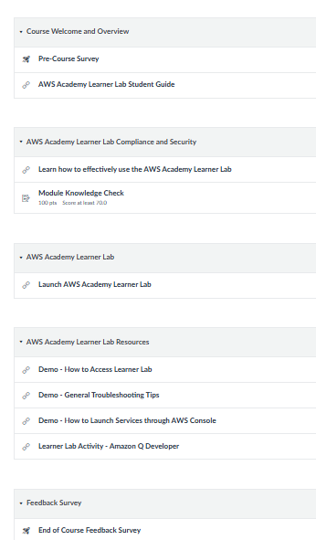  
*Hình 1. Khởi chạy AWS Academy Learner Lab*

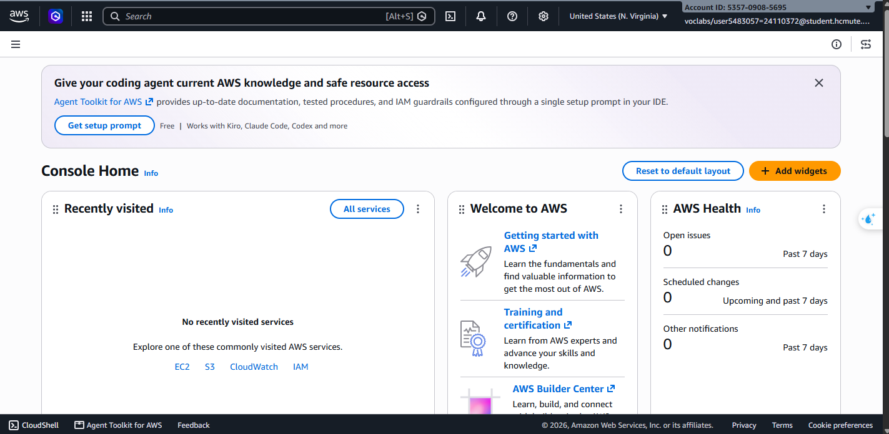  
*Hình 2. AWS Console Home sau khi vào môi trường lab*

### 3.1. Kiểm tra IAM LabRole

Trong IAM, mở Roles và chọn LabRole để kiểm tra ARN. Nhóm dùng role này cho các Lambda, không tạo IAM user hoặc execution role mới theo ràng buộc Learner Lab. ARN được ghi nhận là arn:aws:iam::535709085695:role/LabRole.

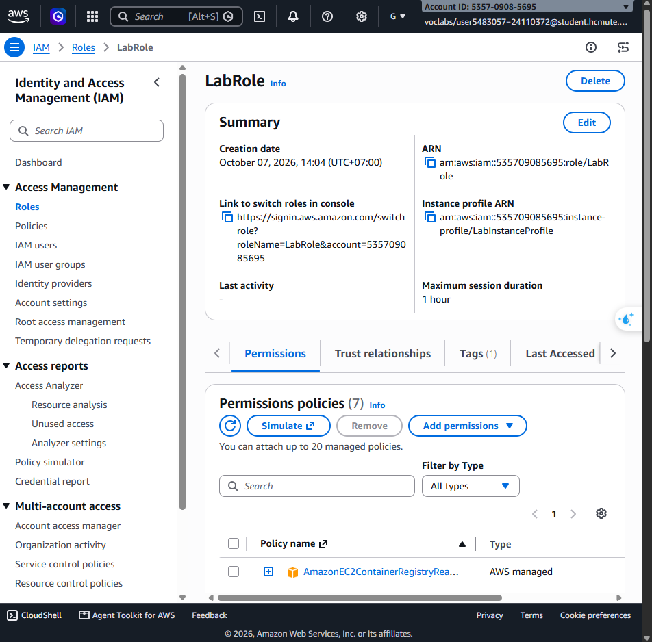  
*Hình 3. Trang thông tin role LabRole và ARN của role*

### 3.2. Tạo VPC, subnet và route table

Trong account chính 535709085695, nhóm tạo VPC textract-pipeline-vpc-535709085695 ở Region us-east-1. VPC có ID vpc-0111c067a9d554f2b và CIDR 10.20.0.0/16. Nhóm chọn VPC only, không cấp IPv6, giữ tenancy Default và thêm các tag Name, Project, Owner.

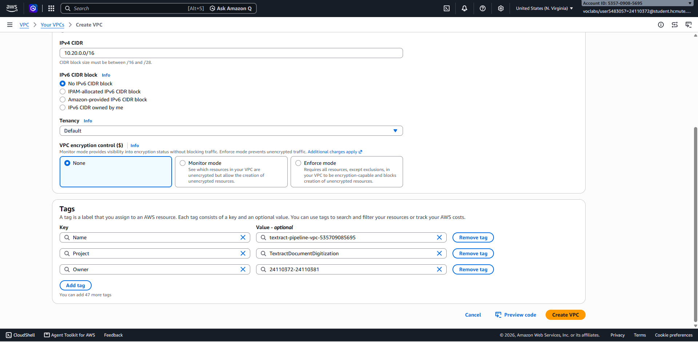  
*Hình 4. Cấu hình VPC: CIDR 10.20.0.0/16, không dùng IPv6, tenancy Default và tags Name/Project/Owner. Account ID 535709085695, us-east-1.*

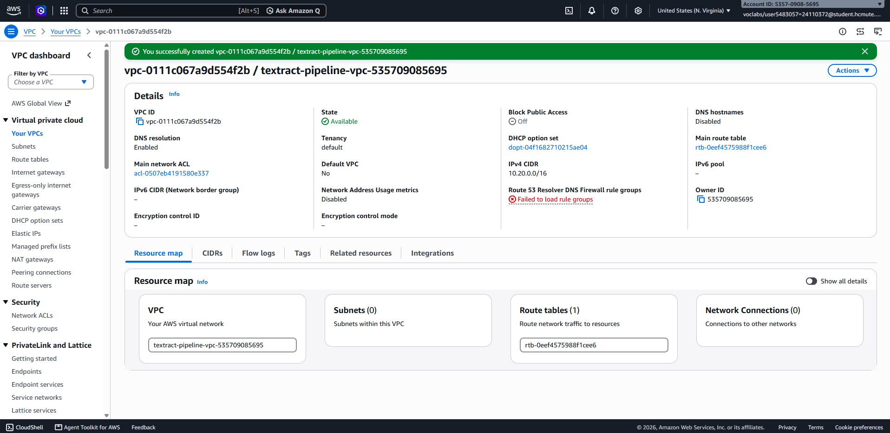  
*Hình 5. VPC vpc-0111c067a9d554f2b được tạo thành công; ảnh chụp ngay trước khi nhóm tạo subnet. Account ID 535709085695, us-east-1. Tệp ảnh lưu lúc 11/10/2026 21:07:38 (UTC+7).*

Nhóm tạo textract-pipeline-subnet-a với CIDR 10.20.1.0/24 ở us-east-1a (use1-az2), và textract-pipeline-subnet-b với CIDR 10.20.2.0/24 ở us-east-1b (use1-az4). Cả hai subnet đều được gắn tag Project = TextractDocumentDigitization và Owner = 24110372-24110381.

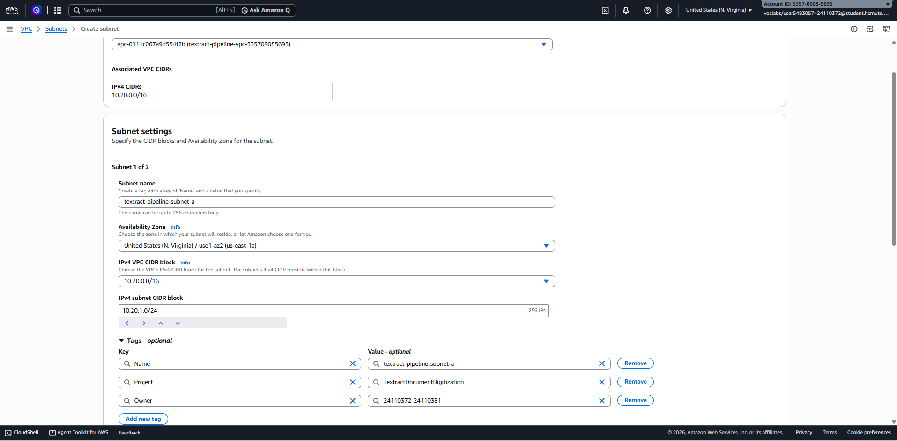  
*Hình 6. Cấu hình subnet A: us-east-1a, CIDR 10.20.1.0/24 và tags Project/Owner. Account ID 535709085695, us-east-1.*

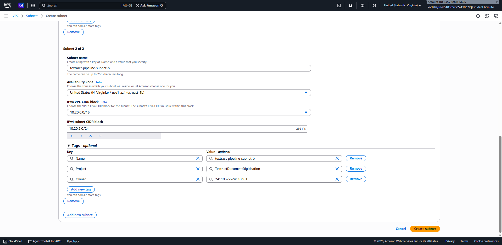  
*Hình 7. Cấu hình subnet B: us-east-1b, CIDR 10.20.2.0/24 và tags Project/Owner. Account ID 535709085695, us-east-1.*

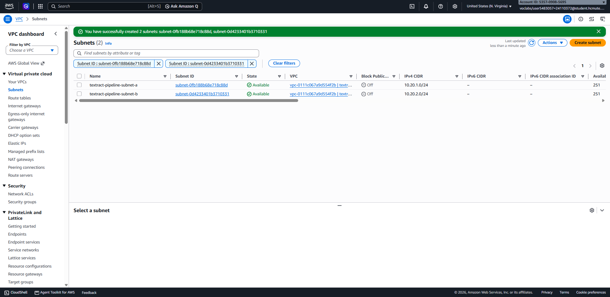  
*Hình 8. AWS Console xác nhận hai subnet đã tạo và ở trạng thái Available. Account ID 535709085695, us-east-1.*

VPC dùng route table chính rtb-0eef4575988f1cee6. Route table có route 10.20.0.0/16 → local; hai subnet không có association riêng nên tự dùng route table chính. Route table cũng được gắn tags Name, Project và Owner. Nhóm không tạo Internet Gateway hoặc NAT Gateway, và để các hàm Lambda ngoài VPC trong giai đoạn kiểm thử này.

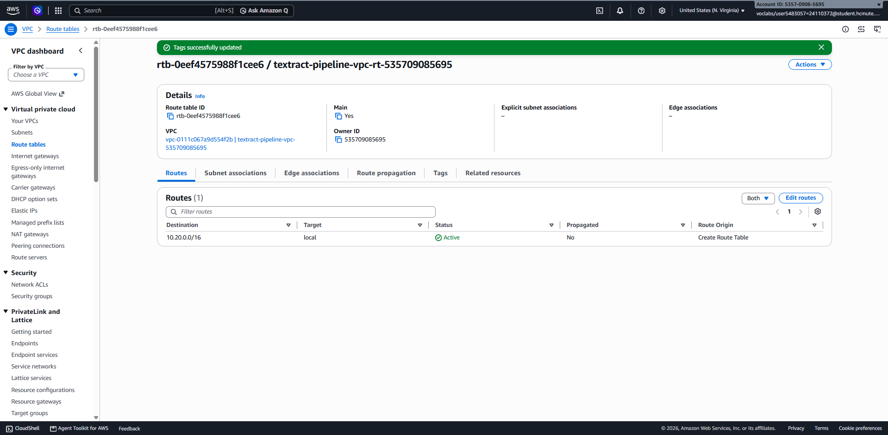  
*Hình 9. Route table chính đã lưu tags; route 10.20.0.0/16 → local ở trạng thái Active. Account ID 535709085695, us-east-1.*

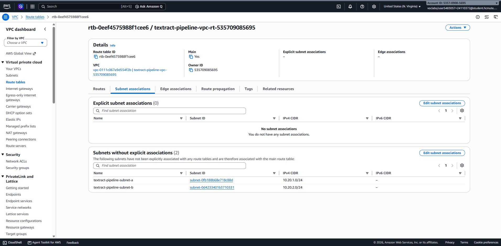  
*Hình 10. Hai subnet không có explicit association riêng và vì vậy dùng route table chính của VPC. Account ID 535709085695, us-east-1.*

### 3.3. Sơ đồ kiến trúc và trạng thái triển khai

Sơ đồ dưới đây mô tả luồng xử lý tài liệu. VPC và hai subnet là phần hạ tầng mạng được dựng riêng trong tuần 1; Lambda chưa được gắn vào VPC nên luồng smoke test hiện chạy bên ngoài VPC.

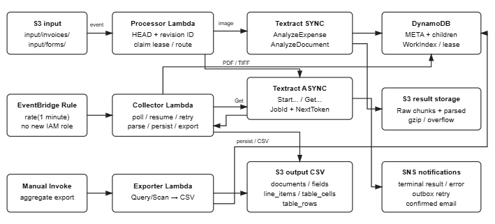  
*Hình 11. Sơ đồ kiến trúc và trạng thái triển khai*

## 4. Các bước tạo tài nguyên nền tảng

### 4.1. Tạo S3 bucket và thiết lập mã hóa

1. Mở Amazon S3, chọn Create bucket, đặt tên textract-pipeline-535709085695 và chọn Region US East (N. Virginia), us-east-1.

2. Trong Default encryption, chọn Server-side encryption with Amazon S3 managed keys (SSE-S3). Nhóm lựa chọn cơ chế mã hóa phía máy chủ SSE-S3 để mã hóa các đối tượng được lưu trữ trong bucket. Nhóm không cấu hình SSE-KMS hoặc DSSE-KMS vì chưa có yêu cầu sử dụng khóa KMS do người dùng quản lý. Sau khi tạo bucket, nhóm kiểm tra trang Properties để xác nhận tên tài nguyên và Region đã cấu hình.

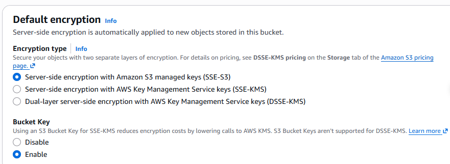  
*Hình 12. Lựa chọn mã hóa mặc định SSE-S3 khi tạo bucket*

3. Tạo bucket, sau đó kiểm tra trang Properties để xác nhận tên bucket và region.

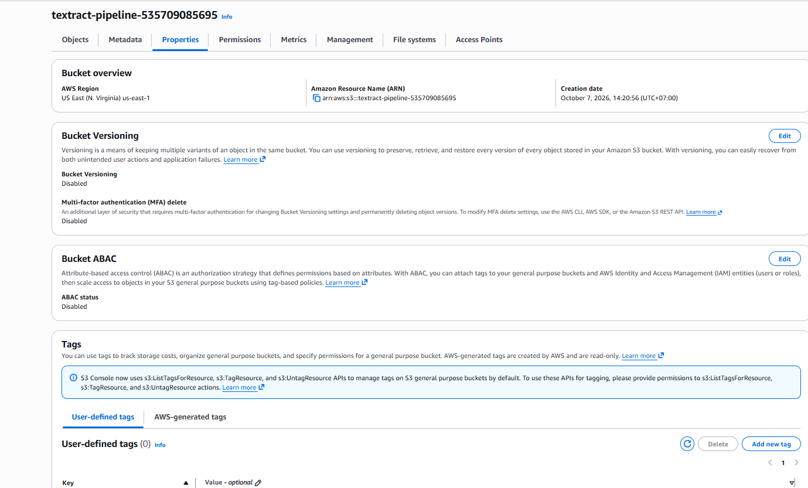  
*Hình 13. Trang Properties xác nhận bucket và region*

### 4.2. Tạo prefix input/ và output/

Trong S3 bucket, tạo hai prefix input/ và output/ để phân loại đối tượng đầu vào và đầu ra. Cấu hình sự kiện S3 được giới hạn ở prefix input/, trong khi các tệp kiểm thử đầu ra được lưu tại output/. Cách tổ chức này giúp tách biệt hai luồng dữ liệu và hạn chế việc tệp đầu ra kích hoạt lại Lambda Processor.

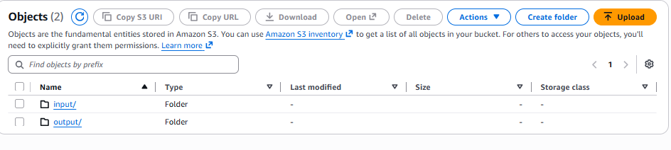  
*Hình 14. Bucket có hai prefix input/ và output/*

### 4.3. Thiết lập tag cho tài nguyên

Nhóm sử dụng thống nhất hai thẻ tài nguyên là Project = TextractDocumentDigitization và Owner = 24110372-24110381. Các thẻ được thiết lập trong quá trình tạo tài nguyên hoặc bổ sung thông qua mục quản lý tags sau khi tài nguyên được khởi tạo. Các hình minh họa tiếp theo ghi nhận trạng thái thẻ trên những tài nguyên tương ứng.

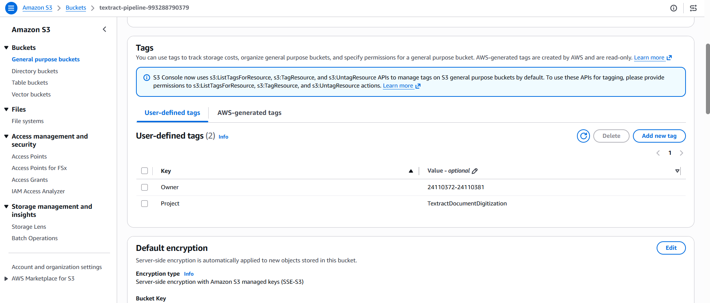  
*Hình 15. Hiển thị hai user-defined tags Project và Owner*

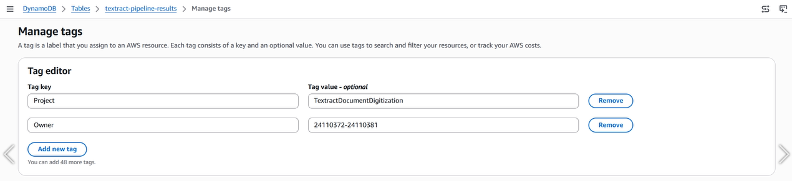  
*Hình 16. Trang Manage tags của DynamoDB table textract-pipeline-results, hiển thị Project và Owner.*

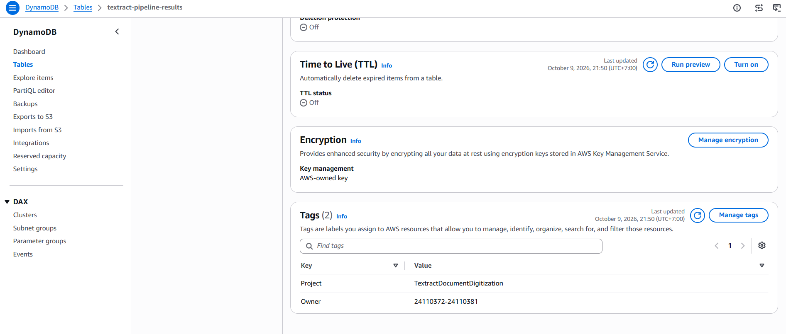  
*Hình 17. Trang Tags của DynamoDB table, xác nhận hai tag Project và Owner đã được lưu.*

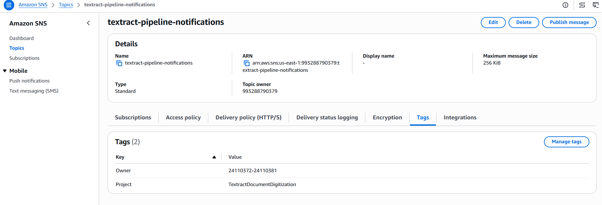  
*Hình 18. Trang Tags của SNS topic textract-pipeline-notifications, hiển thị hai tag Project và Owner*

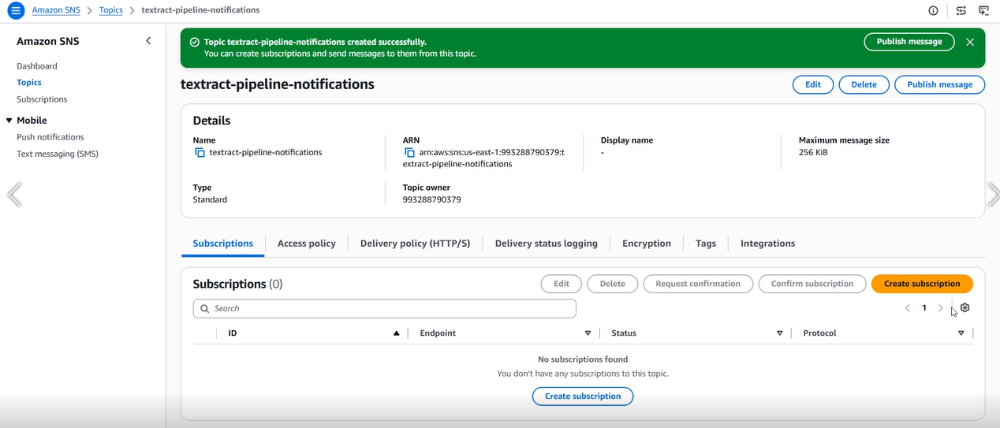  
*Hình 19. Trang chi tiết SNS topic*

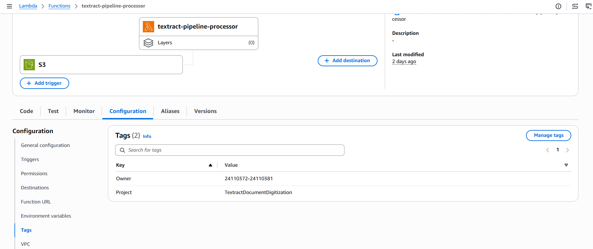  
*Hình 20. Trang Tags của Lambda Processor textract-pipeline-processor, hiển thị Project và Owner*

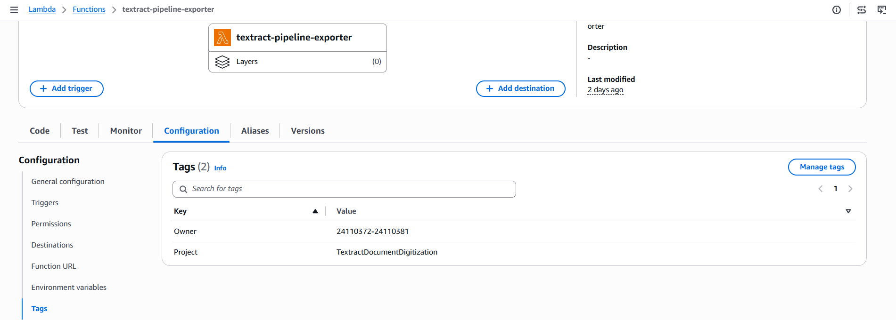  
*Hình 21. Trang Tags của Lambda Exporter textract-pipeline-exporter, hiển thị Project và Owner*

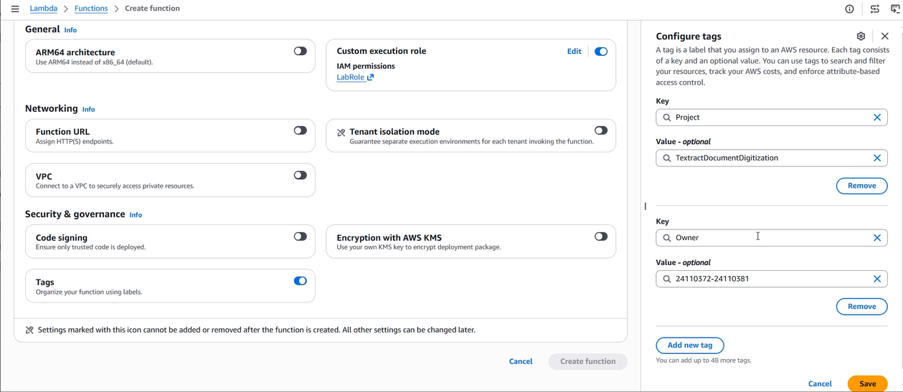  
*Hình 22. Màn hình nhập tags khi tạo Lambda; ảnh minh họa bước cấu hình, còn ảnh 13-14 xác nhận trạng thái tags trên function đã tạo.*

### 4.4. Tạo DynamoDB table

1. Mở DynamoDB → Tables → Create table.

2. Đặt Table name là textract-pipeline-results.

3. Đặt Partition key là PK, kiểu String; Sort key là SK, kiểu String.

4. Giữ chế độ On-demand / Pay-per-request. Sau đó bấm Create table và đợi trạng thái Active.

5. Mở tab Tags và thêm Project = TextractDocumentDigitization, Owner = 24110372-24110381.

Sau khi tạo bảng textract-pipeline-results, nhóm kiểm tra trạng thái hoạt động, khóa phân vùng PK, khóa sắp xếp SK và chế độ dung lượng On-demand. Tại thời điểm ghi nhận, bảng chưa có item vì chức năng trích xuất và ghi kết quả nghiệp vụ chưa được triển khai. Cấu trúc khóa được thiết lập trước để phục vụ việc lưu trữ metadata và các nhóm dữ liệu chi tiết trong giai đoạn phát triển tiếp theo.

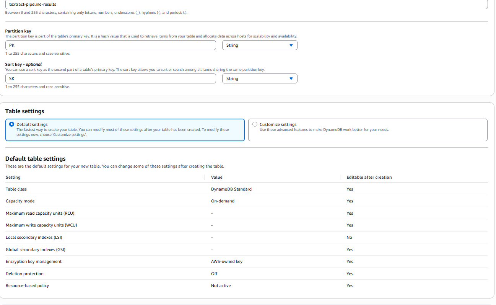  
*Hình 23. Cấu hình tên bảng, PK/SK kiểu String và chế độ On-demand*

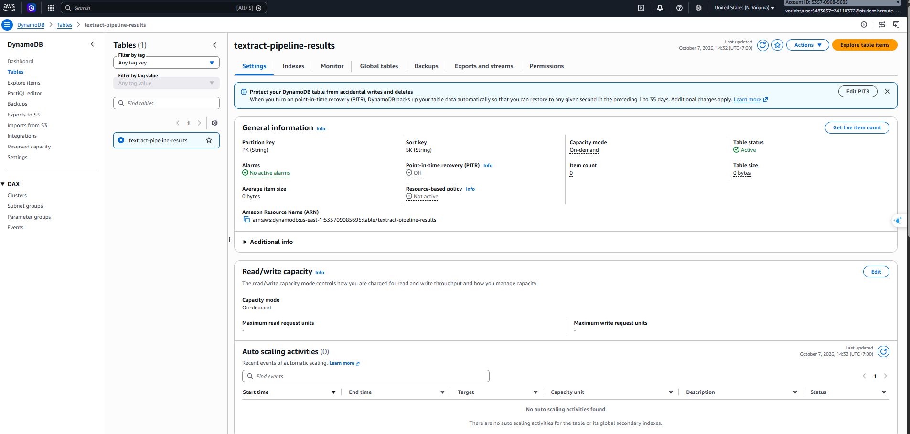  
*Hình 24. Table textract-pipeline-results ở trạng thái Active, capacity mode On-demand, item count bằng 0*

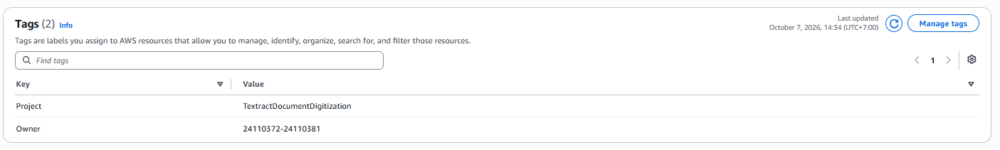  
*Hình 25. Tags Project và Owner của DynamoDB table*

### 4.5. Tạo SNS topic và xác nhận email

1. Mở Amazon SNS → Topics → Create topic và chọn Standard.

2. Đặt tên textract-pipeline-notifications, thêm hai tag Project và Owner, rồi tạo topic.

3. Trong topic, chọn Create subscription; Protocol là Email; Endpoint là địa chỉ email của người nhận.

4. Mở email xác nhận subscription, bấm liên kết xác nhận, rồi quay lại SNS kiểm tra Status là Confirmed.

Sau khi tạo SNS topic textract-pipeline-notifications, nhóm thiết lập email subscription và xác nhận đăng ký thông qua liên kết được gửi đến địa chỉ email đã cấu hình. Trạng thái Confirmed cho thấy subscription đã được xác nhận. Trong tuần 1, nhóm mới kiểm tra việc khởi tạo topic và xác nhận subscription; chức năng gửi thông báo từ Lambda chưa được tích hợp.

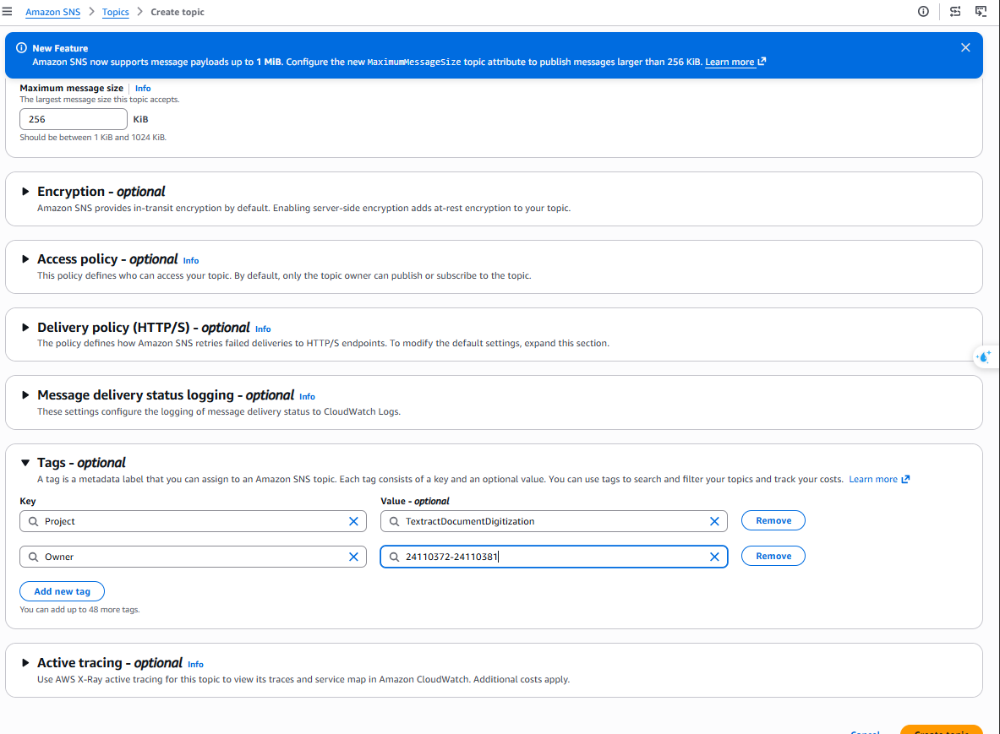  
*Hình 26. Cấu hình SNS Standard topic và hai tag Project, Owner*

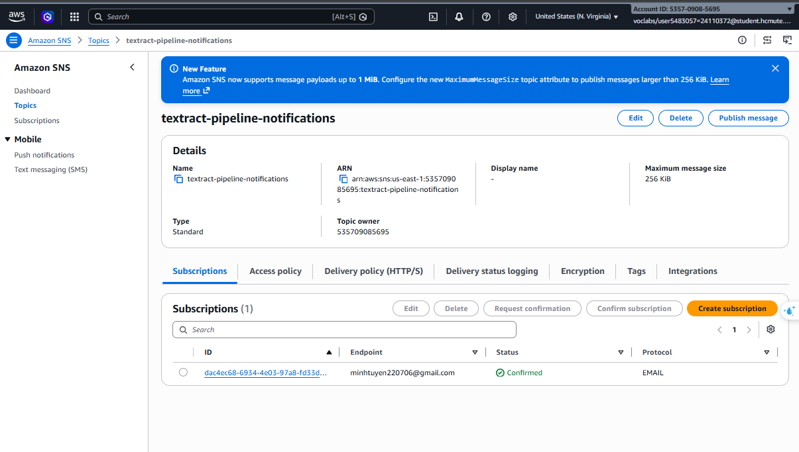  
*Hình 27. Topic textract-pipeline-notifications và email subscription ở trạng thái Confirmed*

### 4.6. Tạo Lambda Processor skeleton

1. Mở Lambda → Functions → Create function → Author from scratch.

2. Đặt Function name là textract-pipeline-processor và Runtime là Python 3.14.

3. Trong Additional settings, giữ architecture x86_64, chọn Custom execution role và dùng role LabRole. Để VPC tắt.

4. Trong Tags thêm Project và Owner. Tạo function. Mở tab Code → lambda_function.py và thay bằng smoke-test code bên dưới; xác nhận Handler là lambda_function.lambda_handler; bấm Deploy.

Mã nguồn kiểm thử thực hiện việc đọc danh sách bản ghi trong sự kiện S3, lấy thông tin bucket và object key, ghi nhật ký JSON lên CloudWatch với trạng thái RECEIVED, sau đó trả về phản hồi có mã trạng thái HTTP 200. Chức năng này chỉ phục vụ kiểm tra khả năng tiếp nhận và đọc cấu trúc sự kiện; chưa thực hiện trích xuất dữ liệu bằng Textract, ghi kết quả nghiệp vụ vào DynamoDB hoặc tạo tệp CSV.

import json

import logging

from urllib.parse import unquote_plus

logger = logging.getLogger()

logger.setLevel(logging.INFO)

def lambda_handler(event, context):

records = event.get("Records", [])

logger.info(json.dumps({

"stage": "event_received",

"request_id": context.aws_request_id,

"record_count": len(records),

}))

processed = []

for record in records:

s3_data = record.get("s3", {})

bucket = s3_data.get("bucket", {}).get("name", "")

key = unquote_plus(s3_data.get("object", {}).get("key", ""))

item = {"bucket": bucket, "key": key, "status": "RECEIVED"}

logger.info(json.dumps({"stage": "s3_object_received", **item}))

processed.append(item)

return {

"statusCode": 200,

"body": json.dumps({"message": "S3 event processed", "objects": processed}),

}

5. Nhóm tạo sự kiện kiểm thử thủ công có tên S3SmokeTest theo cấu trúc sự kiện S3 mẫu và thực thi hàm Lambda. Kết quả ghi nhận trạng thái Succeeded, phản hồi statusCode bằng 200 và một đối tượng đầu vào được xử lý.

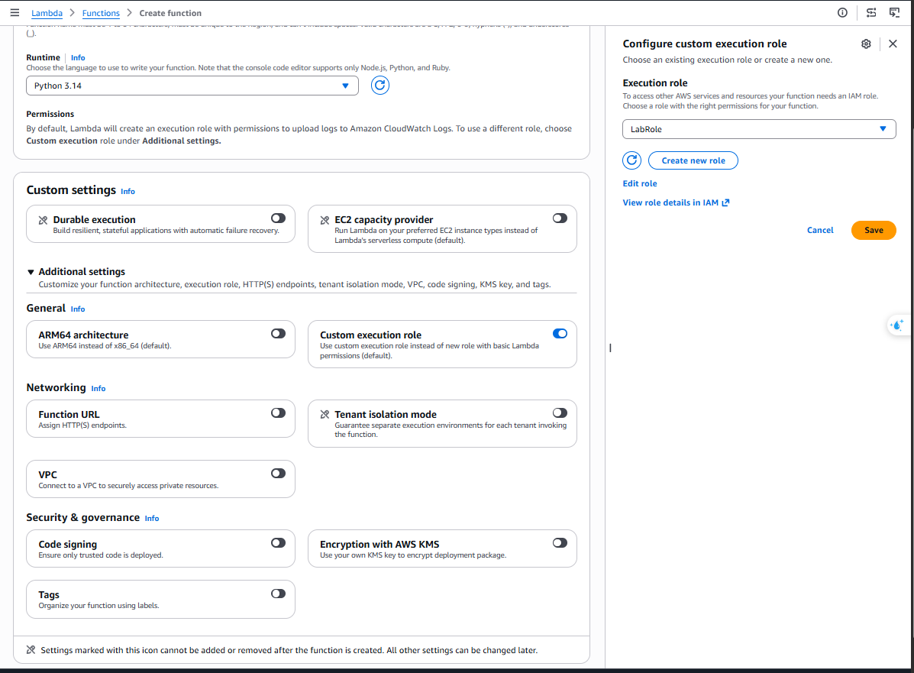  
*Hình 28. Chọn LabRole, giữ x86_64 và để tùy chọn VPC tắt khi tạo Lambda*

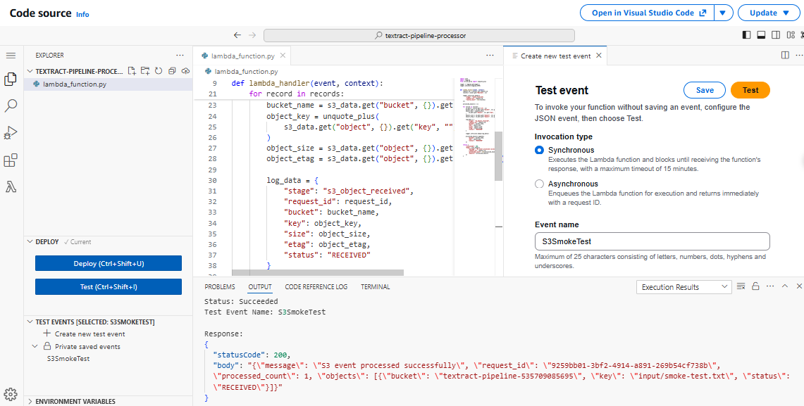  
*Hình 29. Lambda smoke-test event chạy thành công và trả statusCode 200*

### 4.7. Gắn S3 trigger cho Processor

1. Trong trang Lambda Processor, chọn Add trigger → S3.

2. Chọn bucket textract-pipeline-535709085695; Event type là All object create events.

3. Đặt Prefix là input/, để Suffix trống. Xác nhận cảnh báo recursive invocation vì bucket cũng có output/, rồi bấm Add.

Trong lần cấu hình đầu tiên, AWS Console trả về thông báo không thể xác thực cấu hình đích của sự kiện. Qua kiểm tra mục Permissions của Lambda, nhóm xác định resource-based policy chưa có quyền cho phép dịch vụ S3 gọi hàm. Nhóm bổ sung quyền invoke cho principal s3.amazonaws.com, giới hạn theo ARN của bucket nguồn và tài khoản AWS tương ứng, sau đó thực hiện lại thao tác thêm trigger. Kết quả cuối cùng được ghi nhận trong hình minh chứng cấu hình trigger thành công.

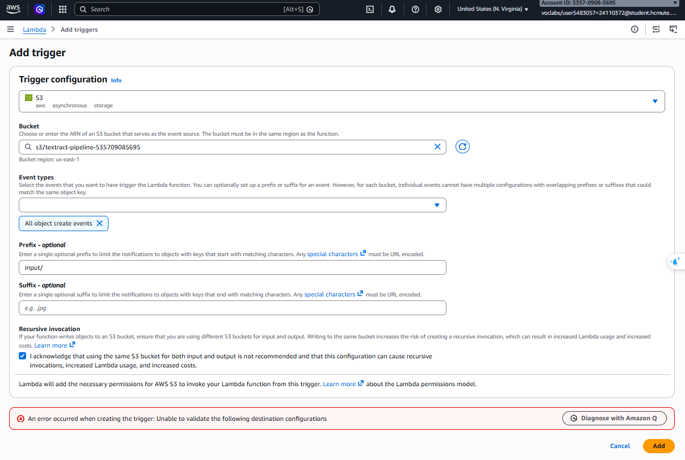  
*Hình 30. Lần thêm trigger đầu tiên: cấu hình prefix input/ đúng nhưng bước validate destination chưa thành công*

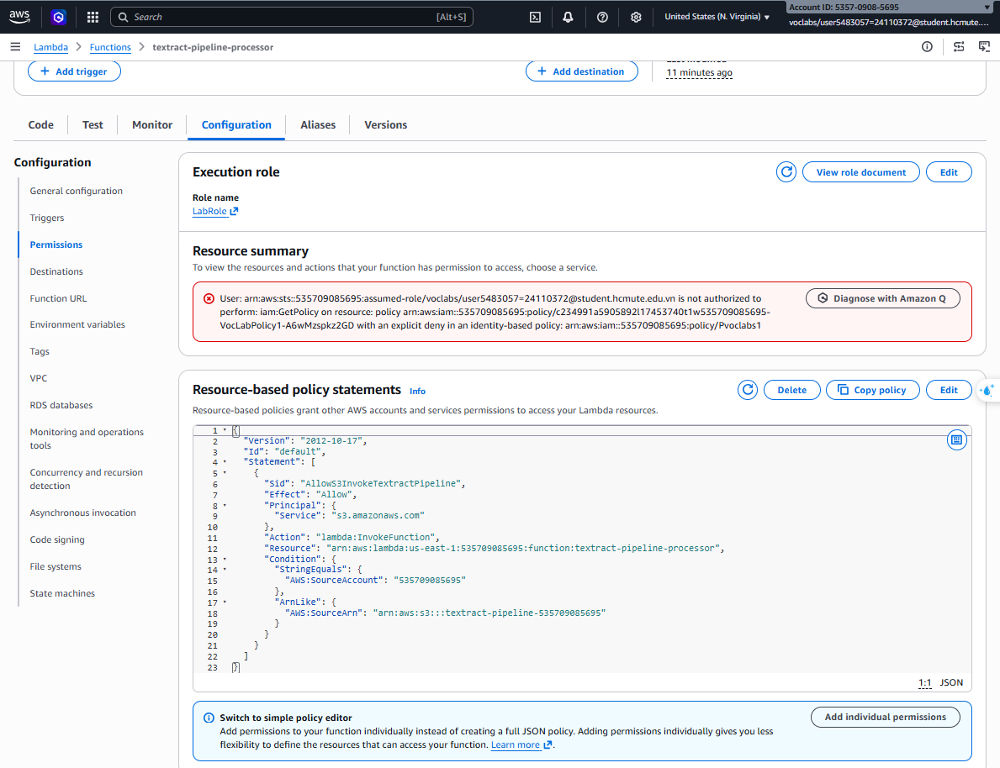  
*Hình 31. Resource-based policy cho phép S3 gọi Lambda, giới hạn theo bucket ARN và account*

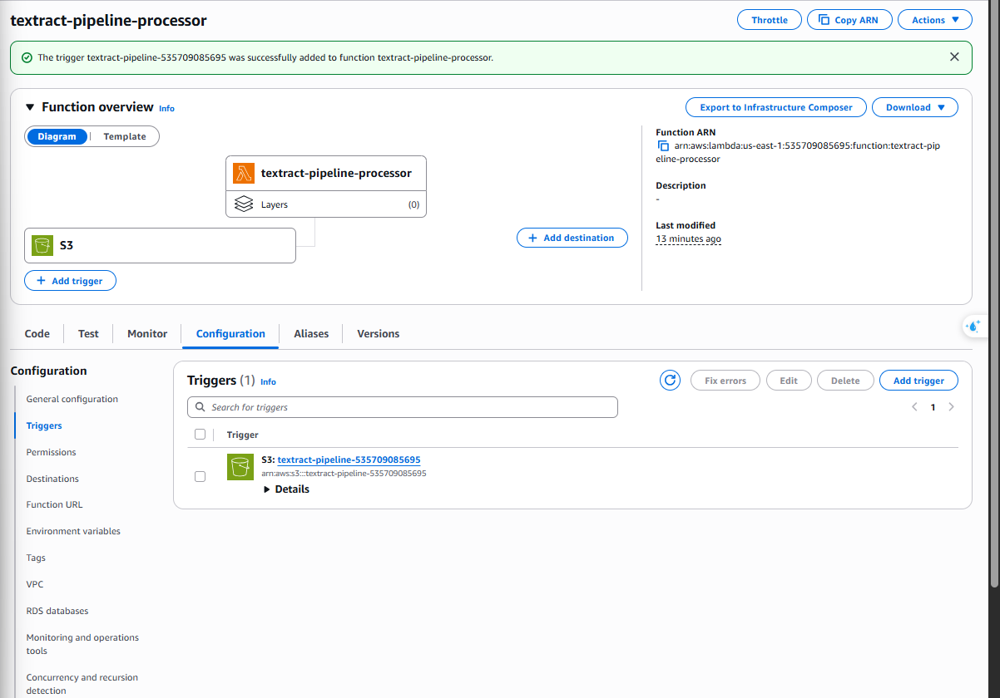  
*Hình 32. AWS Console xác nhận trigger S3 đã được thêm vào Lambda Processor*

### 4.8. Kiểm tra upload vào input/ và CloudWatch Logs

1. Tải file smoke-test.txt lên bucket theo key input/smoke-test.txt.

2. Mở Lambda Processor → Monitor → View CloudWatch logs; vào log group /aws/lambda/textract-pipeline-processor và mở log stream mới nhất.

3. Xác nhận log ghi stage s3_object_received, bucket textract-pipeline-535709085695, key input/smoke-test.txt, status RECEIVED.

CloudWatch ghi nhận invocation vào 2026-10-07 08:03:51 UTC (15:03:51 UTC+7). Thời lượng thực thi hiển thị khoảng 17.59 ms; đây là kết quả smoke test, không phải thời gian chạy Textract.

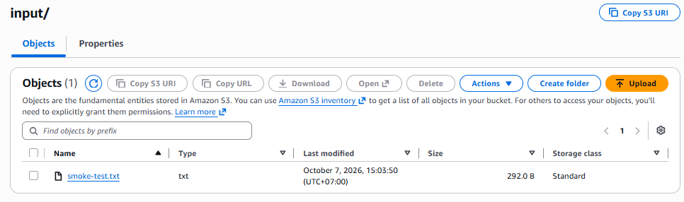  
*Hình 33. File smoke-test.txt đã được tải vào prefix input/*

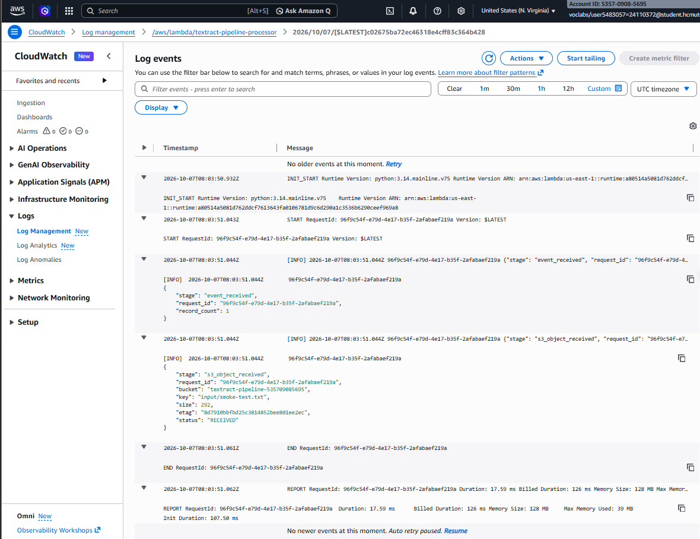  
*Hình 34. CloudWatch log ghi đúng bucket, key input/smoke-test.txt và status RECEIVED*

### 4.9. Kiểm tra output/ không kích hoạt Processor

1. Tải file thử output-smoke-test.csv vào prefix output/.

2. Kiểm tra trang Upload status của S3 để xác nhận file tải lên thành công.

3. Đối chiếu CloudWatch/Lambda invocation sau thời điểm tải output. Không thấy invocation hoặc log mới sau lần xử lý input trước đó.

Ảnh S3 cho thấy output-smoke-test.csv upload thành công vào output/ lúc khoảng 15:10:57 UTC+7, tương đương 08:10:57 UTC. Ảnh Lambda Recent invocations vẫn ghi invocation mới nhất lúc 08:03:51 UTC. Vì vậy file output không gọi Processor; trigger được giới hạn theo prefix input/.

File CSV này là dữ liệu giả để kiểm tra prefix, không phải CSV được sinh từ Textract.

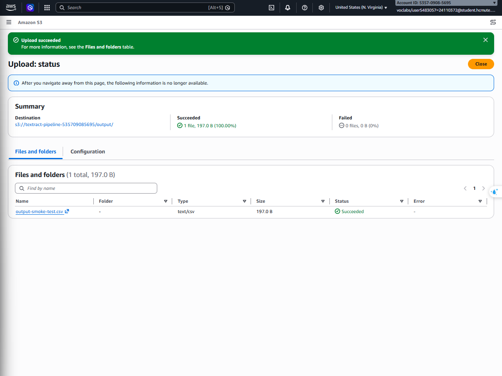  
*Hình 35. S3 xác nhận output-smoke-test.csv upload thành công vào output/*

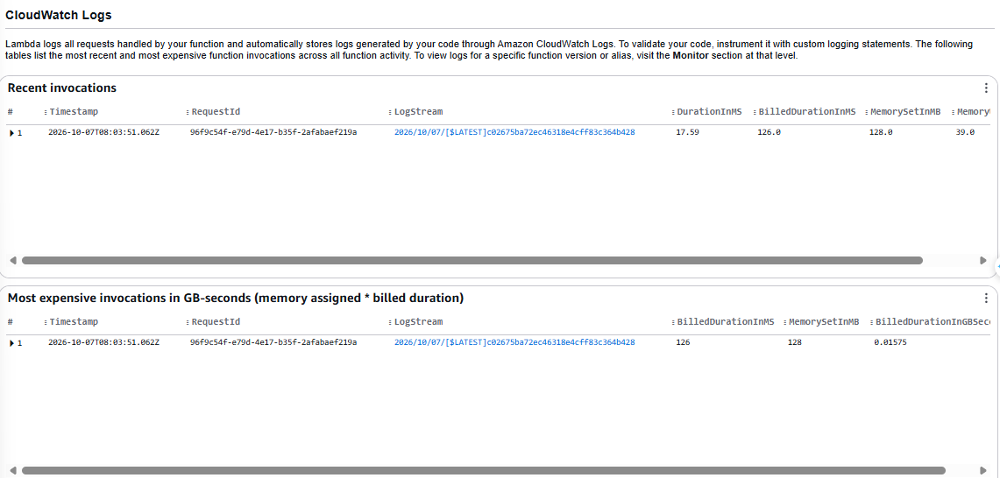  
*Hình 36. Recent invocations cho thấy lần gần nhất trước thời điểm upload output là 08:03:51 UTC*

### 4.10. Tạo Lambda Exporter skeleton

1. Mở Lambda → Functions → Create function → Author from scratch.

2. Đặt Function name là textract-pipeline-exporter, Runtime Python 3.14, architecture x86_64 và execution role LabRole.

3. Không gắn VPC, thêm Project và Owner tags, rồi tạo function.

4. Để code mẫu mặc định, không gắn trigger và không chạy export ở Giai đoạn 1. Chức năng đọc DynamoDB và ghi CSV vào S3 sẽ được thêm ở giai đoạn triển khai lõi.

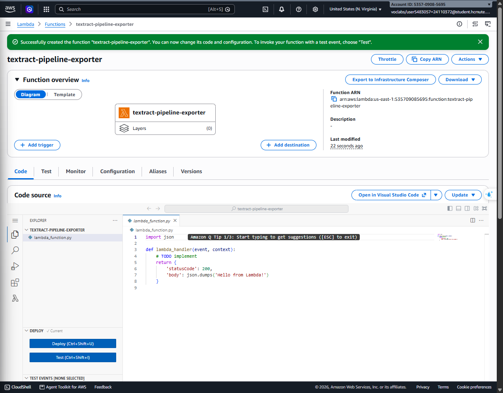  
*Hình 37. Lambda textract-pipeline-exporter được tạo thành công*

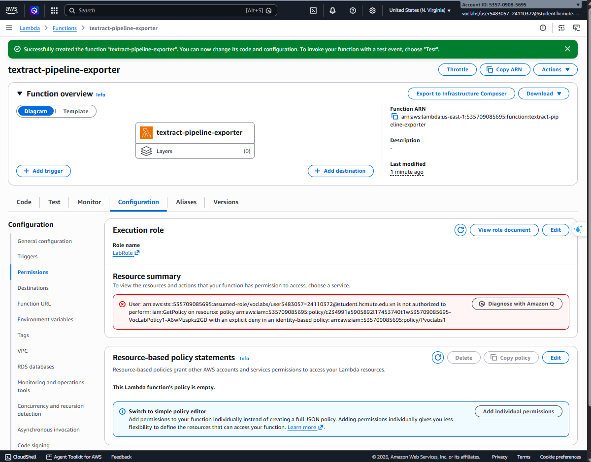  
*Hình 38. Trang Permissions hiển thị execution role LabRole; thông báo đỏ là giới hạn iam:GetPolicy của Learner Lab khi đọc resource summary*

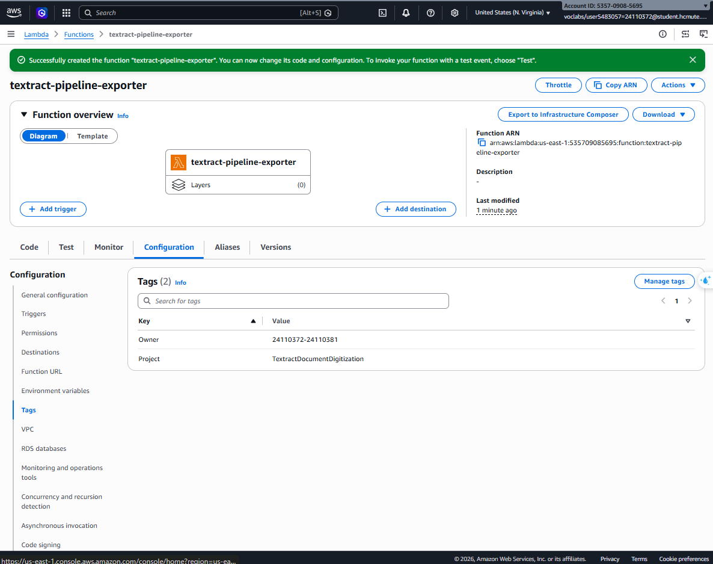  
*Hình 39. Tags Project và Owner của Lambda Exporter*

## 5. Kết quả kiểm thử

| Hạng mục | Kết quả |
| --- | --- |
| DynamoDB table | Bảng ở trạng thái Active, có khóa PK và SK theo cấu hình, sử dụng chế độ On-demand; chưa có item tại thời điểm kiểm tra. |
| SNS topic/email | Standard; ảnh subscription Confirmed thuộc account 535709085695 |
| Lambda test event | Sự kiện kiểm thử thủ công được thực thi thành công, trả về statusCode 200 và xử lý một đối tượng trong event mẫu. |
| S3 input → Processor | Khi tải tệp lên prefix input/, Lambda Processor được kích hoạt và CloudWatch ghi nhận đúng bucket, object key cùng trạng thái RECEIVED. |
| S3 output không gọi Processor | Trong lần kiểm thử được ghi nhận, không quan sát thấy invocation mới sau khi tải tệp lên prefix output/. |
| Lambda Exporter skeleton | Hàm Lambda Exporter đã được tạo; execution role và các thẻ tài nguyên được kiểm tra. |
| Resource tags | Các ảnh minh chứng ghi nhận thẻ Project và Owner trên những tài nguyên tương ứng. |
| VPC, subnet và route table | VPC, hai subnet /24 ở us-east-1a và us-east-1b; route table chính chỉ có route local, hai subnet dùng route table này mặc định. VPC, subnet và route table có tags theo quy ước. |

## 6. Kết luận

Trong tuần 1, nhóm đã tạo VPC cùng hai subnet ở hai Availability Zone, gắn tags và kiểm tra route table chính chỉ có route nội bộ local. Nhóm cũng kiểm tra luồng S3 → Lambda Processor → CloudWatch: tệp trong input/ tạo invocation với trạng thái RECEIVED, còn lượt tải tệp thử lên output/ không tạo invocation mới. Các chức năng Textract, ghi kết quả vào DynamoDB, gửi thông báo từ Lambda và tạo CSV nghiệp vụ sẽ được làm ở giai đoạn sau.

Tuy nhiên, hệ thống chưa hoàn thiện chức năng số hóa tài liệu. Việc trích xuất thông tin bằng Amazon Textract, lưu kết quả vào DynamoDB, gửi thông báo qua SNS và tạo tệp CSV từ dữ liệu thực tế vẫn cần được triển khai. Nhóm cũng chưa kiểm thử trên bộ 30 tài liệu mẫu và chưa đánh giá độ chính xác của kết quả trích xuất.

Trong giai đoạn tiếp theo, nhóm sẽ tập trung tích hợp các chức năng xử lý tài liệu, hoàn thiện luồng lưu trữ và xuất dữ liệu, sau đó tiến hành kiểm thử trên bộ tài liệu mẫu và đánh giá kết quả theo các chỉ số phù hợp. Đây sẽ là cơ sở để xác định mức độ đáp ứng yêu cầu của hệ thống và đề xuất các hướng cải thiện trong quá trình phát triển.

## 7. Bảng kiểm kê tài nguyên (Audit Sheets)

Bảng đối chiếu kiểm tra chất lượng tài nguyên đã triển khai trong Tuần 1:

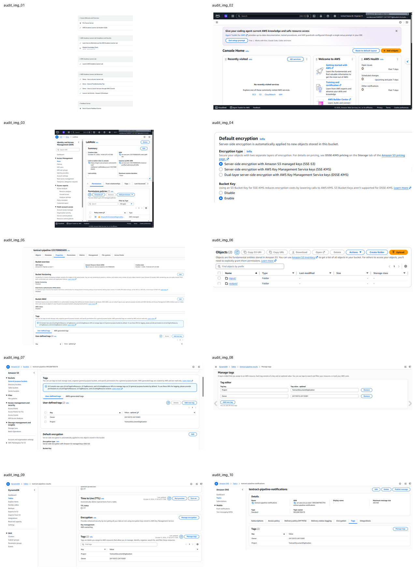  
*Bảng kiểm kê tài nguyên — Trang 1*

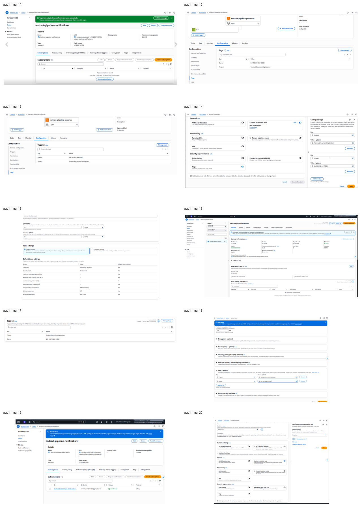  
*Bảng kiểm kê tài nguyên — Trang 2*

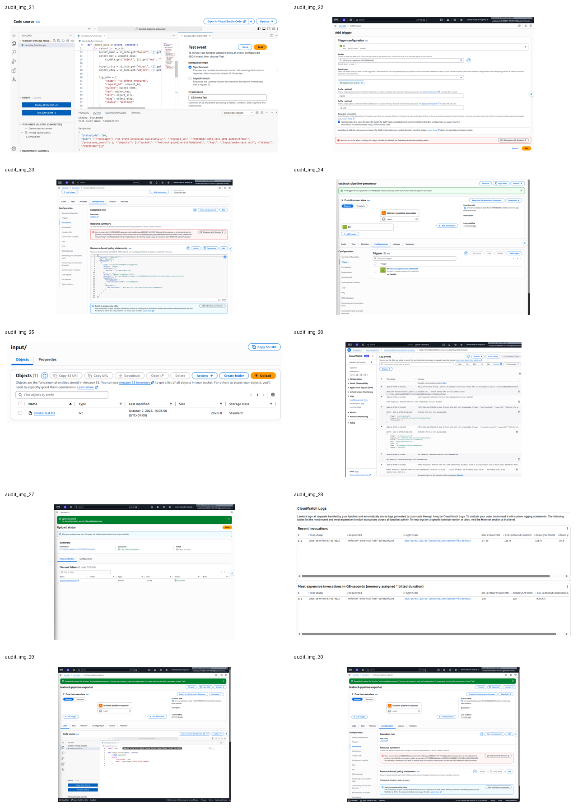  
*Bảng kiểm kê tài nguyên — Trang 3*
